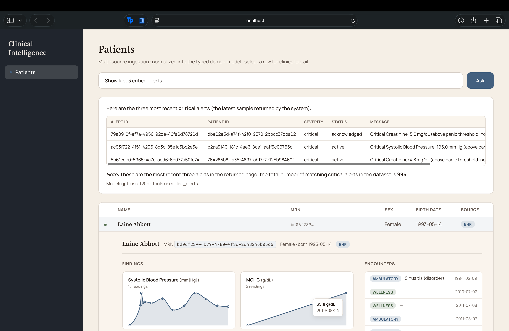

# Clinical Intelligence Dashboard

A full-stack clinical data platform that ingests fragmented medical data from
incompatible sources, reconciles it into one typed model, lets a user ask
questions in plain English, and surfaces the answers in a dashboard where every
alert acknowledgment is audited.



Everything above is running against **1,171 real Synthea patients** — 53k
encounters, 150k findings, 995 derived alerts. Reading the screenshot top to
bottom: the **Ask bar** took a plain-English question, chose the `list_alerts`
tool, and answered from the rows that came back — including the note that those
three are *the returned page*, and that 995 alerts match in total. The footer
records which model answered (`gpt-oss-120b`) and which tools it called. Below
it, the **patient table** pages through the full population, and an expanded row
shows that patient's **lab trends** and **encounter history** side by side.

---

## The problem (business framing)

Clinical data lives in incompatible silos. A hospital's **CSV exports**, an EHR's
**FHIR API**, an analytics team's **PostgreSQL warehouse**, and a radiology archive
full of **DICOM/NIfTI scans** all describe the *same* patients — but in different
shapes, with different ID schemes, different unit conventions, and (for imaging) as
opaque binary files rather than rows.

A clinician or analyst who wants to answer a question like:

> *"Show me patients with a critical hemoglobin finding in the last 30 days who have
> an unacknowledged alert."*

…cannot, because no single system holds that joined-up view. The data exists, but
it is not *queryable together*, and the actions taken on it are not *accountable*.

**This platform turns fragmented clinical data into one queryable, accountable
surface.** It ingests every source, reconciles records that refer to the same
person, exposes the result through a typed API and a dashboard, answers natural-
language questions via constrained LLM function calling, and guarantees that every
alert acknowledgment writes an immutable-by-construction audit record.

---

## Features

**Multi-source ingestion.** CSV files, a FHIR API, a PostgreSQL warehouse, and raw
imaging files (`.dcm` / `.nii`) all map into one shared domain model. Every schema
decision the ingestion layer makes — a coerced date format, a normalized sex code, a
null spelling — is logged as a structured event, so a surprising number downstream
can be traced to the row and rule that produced it.

**Deterministic reconciliation.** The same patient arriving from CSV, FHIR, and SQL
collapses into a single canonical record, matched on `mrn` + `birth_date`. Chosen
over fuzzy matching because clinical data demands that a merge be explainable, not
merely probable.

**Real data, not fixtures.** Ships against the MITRE Synthea export: 1,171 patients,
53k encounters, 150k findings, 855 imaging studies. Synthea publishes no
interpretation and no alerts, so abnormal flags come from an explicit clinical
reference panel (`ingestion/reference_ranges.py`) and **alerts are derived** from
findings that breach a lab panic value — each one linked back to its causal
`Finding`. Real volume is also what forced pagination on every list endpoint.

**Natural-language query (the Ask bar).** Ask in English; the model selects from
function-calling tools that mirror the service layer, and *our* code executes them.
The LLM never writes SQL, never sees the database, and never returns freeform data
to parse — it can only invoke operations we defined. Runs on Claude **or** on the
open models (gpt-oss, GLM, Kimi, DeepSeek) hosted by Virginia Tech ARC: same tool
surface, one `LLM_MODEL` setting apart.

**An eval harness for that query layer.** 35 graded cases scoring tool *selection*,
*arguments*, *chaining*, *refusal*, honest *zero* reporting, and *sampling* — whether
a model describes 995 rows from the 100 it was shown. Graded mechanically on the
structured tool call rather than by another model, which is what makes "can we swap
in a cheaper model?" a number instead of an opinion.

**Imaging split.** Image *metadata* becomes a queryable domain object; image *pixels*
go to an object store, referenced by URI. DICOM headers are de-identified on
ingestion.

**Audited alert workflow.** Acknowledging an alert atomically writes an audit entry
(who, when, prior state) in the same transaction as the status change — an
acknowledgment cannot exist without its audit record.

**Dashboard.** Paged patient table over the full population; expanding a row loads
that patient's lab trends (Recharts, with reference bands and dense series
aggregated rather than overplotted) and encounter history. Colors encoding clinical
state are validated for colorblind separation, and every badge carries its word too,
so state is never conveyed by color alone.

---

## Tech stack

| Concern        | Choice                                            |
|----------------|---------------------------------------------------|
| Backend        | FastAPI + Python 3.11                             |
| Domain models  | Pydantic v2 (the typed contract between layers)  |
| Database       | PostgreSQL 15 + pgvector (SQLite for local/tests) |
| Frontend       | React 18 + TypeScript + Recharts                  |
| LLM            | Function calling — Anthropic Claude, or VT ARC-hosted open models |
| Deployment     | Docker Compose                                     |

---

## Quickstart

One command brings up Postgres, the backend, and the frontend together:

```bash
docker-compose up
```

- Frontend: http://localhost:5173
- API docs (OpenAPI/Swagger): http://localhost:8000/docs
- Health check: http://localhost:8000/health

On first boot the app seeds itself from the sample data in `ingestion/sample_data/`.
The natural-language query endpoint needs a key for whichever model it is pointed at
(copy `.env.example` to `.env`): `ANTHROPIC_API_KEY` for Claude, or `VTARC_API_KEY`
plus `LLM_MODEL=<an ARC model>` for the VT-hosted open models. Without one the rest
of the app runs normally and `/query` returns 503 naming the variable it wants.
`GET /query/model` reports which model the Ask bar is currently wired to.

Without Docker, `./run.sh` starts the backend and frontend together, waits for
seeding, and opens the dashboard (`--fresh` to re-seed, `--no-open` to skip the
browser). See `RUN_LOCAL.txt` for the two-terminal version and the options.

---

## Architecture, top to bottom

The system is a **strict one-directional pipeline**. Data only ever flows left to
right; no layer reaches backwards.

```
   SOURCES              INGESTION           DOMAIN MODEL        SERVICE          API             FRONTEND
 ┌────────────┐     ┌────────────────┐     ┌────────────┐   ┌──────────┐   ┌──────────┐    ┌──────────────┐
 │  CSV       │────▶│ csv adapter    │     │  Patient   │   │ Patient  │   │ /patients│    │ React tables │
 │  files     │     │                │     │  Encounter │   │ service  │   │          │    │ + Recharts   │
 ├────────────┤     ├────────────────┤     │  Finding   │   ├──────────┤   ├──────────┤    ├──────────────┤
 │  FHIR      │────▶│ fhir adapter   │────▶│ ImagingStu.│──▶│ Finding  │──▶│ /findings│──▶ │ NL query box │
 │  API       │     │                │     │  Alert     │   │ service  │   │ /query   │    │              │
 ├────────────┤     ├────────────────┤     └────────────┘   ├──────────┤   ├──────────┤    ├──────────────┤
 │ Postgres   │────▶│ sql adapter    │     (Pydantic v2,    │ Alert    │   │ /alerts  │    │ Alert panel  │
 │ warehouse  │     │                │      the contract)   │ service  │   │ /ack     │    │ + audit log  │
 ├────────────┤     ├────────────────┤                      ├──────────┤   ├──────────┤    ├──────────────┤
 │ DICOM /    │────▶│ imaging adapter│                      │ Imaging  │   │ /imaging │    │ Image viewer │
 │ NIfTI      │     │ (pydicom/      │                      │ service  │   │ /{id}    │    │              │
 │ (.dcm/.nii)│     │  nibabel)      │                      └──────────┘   └──────────┘    └──────────────┘
 └────────────┘     └──────┬─────────┘
                           │
        metadata ──────────┴────────▶ becomes an ImagingStudy (header → typed fields → normal path)
        pixels   ──────────────────▶ ┌────────────────────┐
                                      │   OBJECT STORE     │ ◀── ImagingStudy.image_uri references this
                                      │  (blob: S3 / disk) │     metadata in Postgres · pixels in blob
                                      └────────────────────┘

   Bottom rails:  every adapter ──▶ transformation log (each mapping decision is recorded)
                  Postgres holds rows + audit_trail · pgvector powers NL / semantic search
```

**The single most important idea:** the **Domain Model** in the middle is the
*contract*. Everything to its left exists to produce those objects; everything to
its right exists to consume them. It is built first, because every other layer
depends on it.

### The layers

| Layer        | Lives in            | Job                                                         | Talks to              |
|--------------|---------------------|------------------------------------------------------------|-----------------------|
| Ingestion    | `ingestion/`        | Map messy source data → domain objects; log every transform | Sources → Domain      |
| Domain Model | `domain/`           | The typed contract — Pydantic v2 classes + validation       | (depended on by all)  |
| Service      | `backend/services/` | Business logic, DB reads/writes — the *only* place SQL lives | Domain ↔ DB           |
| API          | `backend/routers/`  | HTTP routes, request/response validation, no business logic | Service ↔ HTTP        |
| Frontend     | `frontend/`         | Render data, NL query box, alert workflow                   | API over HTTP         |
| Object store | blob (S3 / disk)    | Holds raw imaging pixels; domain references them by URI      | Imaging adapter → API |

### Architecture rules (enforced, not aspirational)

1. Data flows in one direction: **Ingestion → Domain → Service → API → Frontend**.
2. **No raw SQL in route handlers** — routes call services; only services touch the DB.
3. **No raw dicts between layers** — always a typed Pydantic model.
4. Ingestion **logs every schema-transformation decision** (structured logging).
5. **Every LLM call uses function calling**, never freeform text parsing.
6. **Every alert acknowledgment writes an audit-trail row** — no silent state changes.

### Domain model

Five objects, each inheriting a shared `DomainBase` envelope (canonical UUID `id`,
created/updated timestamps, `source_system`, `source_record_id`, `data_quality_score`):

```
Patient 1 ───< Encounter 1 ───< Finding
   │                  │
   │                  └──────< ImagingStudy
   │
   └──────────────────────< Alert  ───< AuditEntry (written on acknowledge)
```

- **Patient** — `mrn`, name, `birth_date`, `sex` (enum), `deceased`.
- **Encounter** — visit context, class/status enums, linked to a patient.
- **Finding** — an observation (`code`, `display`, `value`, normalized `unit`,
  `abnormal_flag`, reference range) plus `raw_value`/`raw_unit` for auditability.
- **ImagingStudy** — `modality` (enum), `body_part`, `study_date`, `series_count`,
  `image_uri` (a pointer to pixels in the object store, **not** the bytes),
  `source_format` (DICOM/NIfTI).
- **Alert** — `severity`/`status` enums, with an `AuditEntry` written on acknowledge.

Two design choices drive the rest of the system:

- **Canonical UUID `id` separate from source `mrn`.** Sources use different ID
  formats for the same person; one internal ID is the place reconciliation writes
  its result. *(It does not itself do the matching — that is the reconciliation step.)*
- **ImagingStudy stores metadata + a URI; pixels live in an object store.** A single
  study is tens-to-hundreds of MB of volumetric data — serializing that into JSON or
  DB rows would wreck both the API and the database. Metadata is small and queryable;
  pixels are large and streamed. *(Trade-off: a second storage system and a
  consistency concern — so the imaging adapter writes the blob before committing the row.)*

### Data sources & ingestion

Every source implements the same `IngestionAdapter` interface (`read() -> Iterable[DomainObject]`),
so a new source is a new adapter, not a pipeline rewrite.

- **CSV** (`csv_adapter.py`, `csv_clinical.py`) — deliberately messy sample data
  (mixed date formats, sex codes, null spellings); each fix is logged.
- **FHIR** (`fhir_adapter.py`) — flattens FHIR's nested, reference-heavy JSON
  (`Patient`, `Observation`, `Encounter`, `ImagingStudy`) onto the domain model.
- **SQL** (`sql_adapter.py`) — reads an external Postgres/SQLite warehouse → domain.
- **Imaging** (`imaging_adapter.py` + `blob_store.py`) — opens `.dcm` (pydicom) /
  `.nii` (nibabel), de-identifies DICOM headers, sends pixels to the blob store, and
  maps the header onto an `ImagingStudy`.
- **Reconciliation** (`reconcile.py`) — matches records across sources on a
  **deterministic key (`mrn` + `birth_date`)**, then assigns/looks up the canonical
  UUID and merges. Deterministic matching is auditable and explainable, which
  clinical data demands.

### LLM natural-language query layer

The user types a question. It goes to the model **with function-calling tools** whose
schemas mirror the services (e.g. `find_patients(filters)`, `get_findings(patient_id,
since)`). The model chooses the tools and arguments; **our code** executes them against
the service layer and returns typed results. The model never writes SQL and never
returns freeform data to parse — it can only invoke operations we defined, so it
cannot read or mutate anything outside the allowed surface. pgvector supports
semantic lookups where a filter is fuzzy. Questions outside the available tools are
declined honestly rather than guessed at.

**Two providers, one loop.** `backend/llm/providers.py` keeps the loop above
provider-agnostic: Anthropic returns content blocks and takes tool results as a user
turn, while OpenAI-compatible servers return `tool_calls` and take them as `role:
"tool"` messages. Each adapter owns its own wire format, so `QueryEngine` never
branches on which model it is talking to. That buys the second provider:
[VT ARC's hosted models](https://www.docs.arc.vt.edu/ai/011_llm_api_arc_vt_edu.html)
— gpt-oss-120b, GLM-5.2, Kimi-K3, DeepSeek-V4-Flash — at
`https://llm-api.arc.vt.edu/api/v1`, free to VT accounts.

The registry in `backend/llm/models.py` exists because ARC serves the same weights
under several ids that differ only in thinking budget (`reasoning_effort`,
`enable_thinking`). Those are request parameters, not endpoints, so the id alone is
not enough to call one correctly — the spec carries the parameters with it.

```bash
python evals/run_eval.py --list-models          # the registry, and what's reachable
LLM_MODEL=GLM-5.2 uvicorn backend.main:app      # the dashboard, on an ARC model
python evals/run_eval.py --model gpt-oss-120b --repeat 3 --temperature 0
```

The point of holding the tool surface fixed across providers is that the eval
harness measures the *model*, not the plumbing — and it grades format, tool
selection, and arguments separately, because "emitted arguments that weren't JSON"
and "chose the wrong tool" are different problems with different fixes.

### Audited alert workflow

Acknowledging an alert is not a simple status flip. `alert_service.acknowledge()`
changes the alert's state **and** writes an `AuditEntry` (who, when, prior state) in
the **same transaction** — so an acknowledgment can never exist without its audit
record. *(This is atomic, not tamper-proof; true immutability would need append-only
/ WORM storage.)*

---

## Build approach

Built as **vertical slices, not horizontal layers**: define the domain model, then
drive *one* object (Patient) end-to-end through every layer before widening. This
surfaces cross-layer integration bugs — the genuinely hard part — early, when fixes
are cheap.

| Phase | Scope | Status |
|-------|-------|--------|
| 1 | Domain models (5 objects on a shared `DomainBase`) | ✅ 16 tests |
| 2 | Patient vertical slice: CSV → ingestion → service → API → React table | ✅ 28 tests |
| 3 | Encounter / Finding / ImagingStudy / Alert through the proven path + Recharts | ✅ 33 tests |
| 4a | FHIR + SQL adapters + deterministic reconciliation | ✅ |
| 4b | Imaging (`.dcm`/`.nii`) ingestion + blob store + DICOM de-identification | ✅ |
| 4c | LLM natural-language query layer (Claude function calling) | ✅ |
| 4d | Audited alert acknowledge workflow | ✅ |
| 5a | Real data (Synthea) + derived alerts + pagination on every list endpoint | ✅ 77 tests |
| 5b | Multi-model Ask layer (Anthropic + VT ARC) + the eval harness | ✅ |
| — | **All phases complete** | ✅ **135 tests** |

---

## Testing

| Layer     | What's tested                                              | How                       |
|-----------|-----------------------------------------------------------|---------------------------|
| Domain    | valid data builds, invalid data raises                    | pytest, no I/O            |
| Ingestion | raw row/file → correct domain object; transforms logged   | pytest + sample fixtures  |
| Imaging   | header → ImagingStudy; pixels uploaded; PHI stripped      | pytest + tiny `.dcm`/`.nii` |
| Service   | business logic + DB reads/writes                          | pytest against a test DB  |
| API       | routes return right shape/status                          | FastAPI TestClient        |
| LLM       | right tool chosen; both provider wire formats             | pytest with mocked clients |
| Eval      | the *scorer* — a buggy grader is worse than no grader     | pytest, hand-built results |

```bash
pytest        # 135 tests, no API key and no network
```

The suite never calls a model. Grading a *live* one costs real requests, so that
lives in `evals/` and is run deliberately:

```bash
python evals/run_eval.py --list-models        # what's wired up, and reachable
python evals/run_eval.py --model GLM-5.2 --repeat 3
```

---

## Known limitations & production-gap analysis

Stated honestly — these are deliberate scope cuts, not oversights:

- **No auth / RBAC.** Real clinical data needs authentication, role-based access,
  and PHI access logging. Out of scope for the demo.
- **Reconciliation is deterministic only.** Mistyped MRNs or DOBs won't match;
  production would add probabilistic record linkage.
- **No streaming ingestion.** Adapters run in batch. Live EHR feeds would need a
  queue (Kafka/Kinesis) and incremental upserts.
- **Audit trail is atomic, not tamper-proof.** True immutability needs WORM storage.
- **LLM answers are bounded by defined tools.** Unsupported questions are declined
  rather than guessed at — a safety feature, but a coverage limit.
- **Imaging is metadata + a stored blob, not a PACS.** No DICOM networking
  (C-STORE / C-FIND / WADO), no full diagnostic viewer with windowing, and no
  redaction of PHI burned *into* the pixels.

## How this scales to 10× data volume

- **Ingestion:** move from batch adapters to a queue + worker pool; make upserts
  idempotent on canonical ID so reruns are safe.
- **Database:** index on `patient_id` and `observed_at`; partition `findings` by
  time; move pgvector to a dedicated read replica.
- **Imaging / blobs:** keep pixels in object storage behind a CDN with signed URLs;
  stream studies to the browser instead of proxying through the API; pre-generate
  downsampled thumbnails so list views never pull full studies.
- **API:** cursor-based pagination on every list endpoint; response caching for hot reads.
- **LLM:** cache tool results and add prompt caching on the static tool schemas so
  only the question varies per call.
